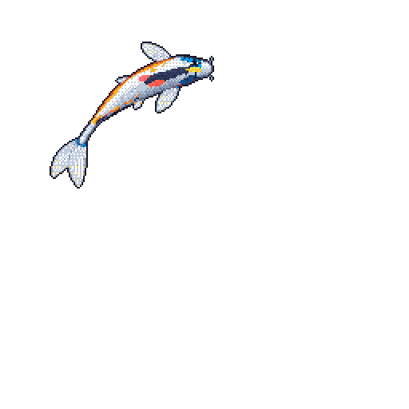

### logan darbz .⋆❀°

low-level things, mostly in c, c++ and rust.

currently building **[nasdaq-orderbook](https://github.com/logandarby/nasdaq-orderbook)**: rebuilding nasdaq order books with low-latency layouts and lock-free queues.

✮ [microbit-async-runtime](https://github.com/logandarby/microbit-async-runtime) · custom async runtime for the micro:bit 
✮ [tiny-basic-compiler](https://github.com/logandarby/tiny-basic-compiler) · a small, fast tiny basic compiler 
✮ [chip-8-emulator](https://github.com/logandarby/chip-8-emulator) · chip-8 emulation in rust 
✮ [stm32f4-bootloader](https://github.com/logandarby/stm32f4-bootloader) · bootloader and host cli for stm32f4

 
